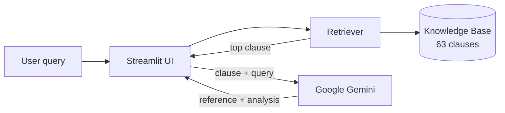

<div align="center">

# 🤖 BIS Saarthi — Compliance Assistant

**An AI-powered assistant that helps manufacturers and entrepreneurs understand Bureau of Indian Standards (BIS) rules and check product compliance — in plain, conversational language.**


[Live Demo](#) · [Report Bug](../../issues) · [Request Feature](../../issues)

</div>

---

## 📖 About

Navigating BIS regulations — ISI marks, hallmarking, CRS registration, licensing — is confusing for small manufacturers and startups. **BIS Saarthi** ("saarthi" = guide) lets users simply *ask a question* or *paste a product description*, and responds with:

1. **The official standard reference** — standard name, clause number and rule text.
2. **A personalised analysis** — a friendly explanation of what the rule means for *their* product.

Built as a **Smart India Hackathon (SIH)** project.

## ✨ Features

- 💬 **Chat interface** built with Streamlit
- 🔍 **Clause-level retrieval (RAG-style)** over a curated knowledge base of **63 BIS clauses**
- 🧠 **Gemini-powered answers** that cite the retrieved standard before giving advice
- ✅ **Compliance analysis chain** (`compliance_engine.py`) producing a *Meets / Does Not Meet* verdict with required changes
- 🏷️ Broad coverage across **10 service areas** (see below)

## 📚 Knowledge Base Coverage

| Area | Examples |
|------|----------|
| Hallmarking | Gold (IS 1417), Silver (IS 2790) |
| Product Certification (ISI / CRS) | Toys (IS 9873), Helmets (IS 4151), Electronics, Batteries, Appliances |
| Automotive | Tyres, wheel rims, fuels, mirrors, fire extinguishers |
| Construction Materials | Cement, steel bars, aggregates, HDPE pipes |
| Food & Drinks | Packaged water, milk products, HACCP |
| Chemicals | Acids, solvents, PVC resins, food-contact plastics |
| Licensing & Enforcement | BIS Act 2016 (Sections 16–18, 29, 31), Conformity Assessment Regulations 2018 |

## 🏗️ How It Works



1. The user's message is tokenised and stop words are removed.
2. Each clause is scored — keyword matches weigh **3×**, general text matches **1×**.
3. The top clause is passed to Gemini with a structured prompt (rule first, then advice).
4. The response is shown in the chat.

More detail in [`docs/architecture.md`](docs/architecture.md).

## 📂 Project Structure

```
BIS-SIH/
├── app.py                  # Streamlit chat UI + Gemini call
├── retriever.py            # Keyword-based clause retrieval
├── knowledge_base.py       # Chunk dataclass + BIS clause data
├── compliance_engine.py    # LangChain compliance-analysis chain
├── requirements.txt        # Python dependencies
├── docs/
│   └── architecture.md     # Architecture diagram & component notes
├── assets/                 # App screenshots used in this README
├── .streamlit/
│   └── secrets.toml.example
├── .env.example
├── .devcontainer/          # GitHub Codespaces config
├── CONTRIBUTING.md
├── LICENSE
└── README.md
```

## 🚀 Getting Started

### Prerequisites
- Python 3.11+
- A free [Google Gemini API key](https://aistudio.google.com/app/apikey)

### Installation

```bash
# 1. Clone the repository
git clone https://github.com/<your-username>/BIS-SIH.git
cd BIS-SIH

# 2. (Optional) create a virtual environment
python -m venv .venv
source .venv/bin/activate        # Windows: .venv\Scripts\activate

# 3. Install dependencies
pip install -r requirements.txt
```

### Configure your API key

Pick **one** option:

```bash
# Option A: environment variable
export GOOGLE_API_KEY="your_key"          # Windows (PowerShell): $env:GOOGLE_API_KEY="your_key"

# Option B: Streamlit secrets
cp .streamlit/secrets.toml.example .streamlit/secrets.toml
# then edit the file and add your key
```

> 🔒 `.env` and `secrets.toml` are git-ignored — never commit your API key.

### Run

```bash
streamlit run app.py
```

Open <http://localhost:8501>.

### ☁️ Deploy on Streamlit Community Cloud
1. Push this repo to GitHub.
2. Create a new app at [share.streamlit.io](https://share.streamlit.io) pointing to `app.py`.
3. Add `GOOGLE_API_KEY` under **App settings → Secrets**.

## 💡 Example Queries

- *"Do I need a BIS licence to sell toys for kids under 10?"*
- *"What are the hallmarking requirements for 22K gold jewellery?"*
- *"What is the penalty for selling goods without an ISI mark?"*
- *"I manufacture packaged drinking water — which standard applies?"*

## 🖼️ Screenshots

| Official reference first | Personalised analysis |
|:---:|:---:|
|  |  |
| **Licence application guidance** | **Detailed requirements breakdown** |
|  |  |
| **Next steps for the business** | **Marking & labelling guidance** |
|  |  |

## 🗺️ Roadmap

- [ ] Replace keyword search with embedding-based semantic retrieval
- [ ] Return top-k clauses instead of top-1
- [ ] Wire `compliance_engine.py` into the UI as a "Check Compliance" mode
- [ ] Multilingual support (Hindi and regional languages)
- [ ] Expand the knowledge base with more standards
- [ ] Add unit tests for the retriever

## ⚠️ Disclaimer

This is a prototype for educational/hackathon purposes. The knowledge base is a simplified summary of BIS standards and **must not be treated as legal or official certification advice**. Always verify with the official [BIS website](https://www.bis.gov.in) before making compliance decisions.

## 🤝 Contributing

Contributions are welcome! See [CONTRIBUTING.md](CONTRIBUTING.md).

## 📄 License

Distributed under the MIT License. See [`LICENSE`](LICENSE).

## 👥 Team

| Name | Role | GitHub |
|------|------|--------|
| _Your Name_ | _Role_ | [@username](https://github.com/username) |

---

<div align="center">Made with ❤️ for Smart India Hackathon</div>
